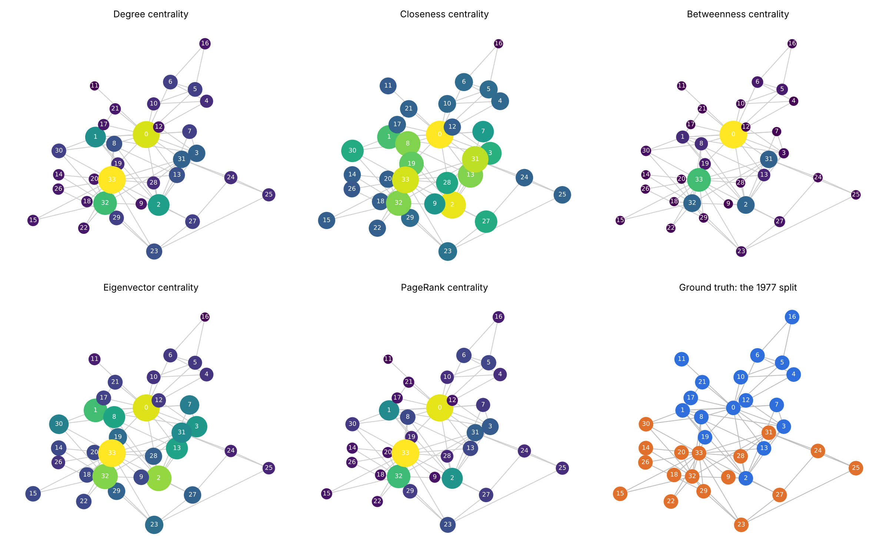
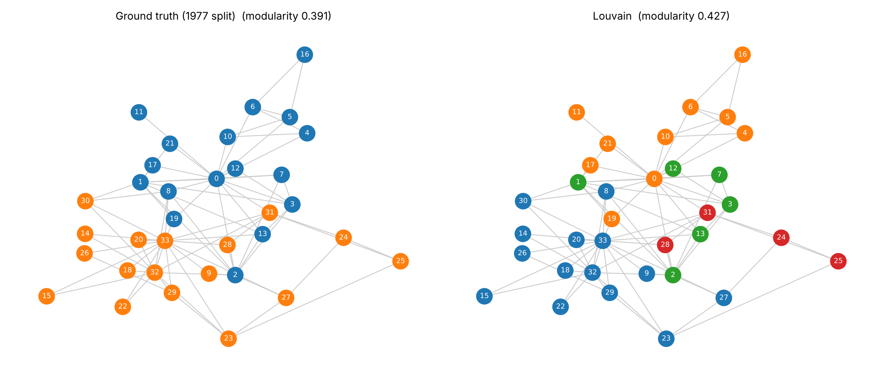
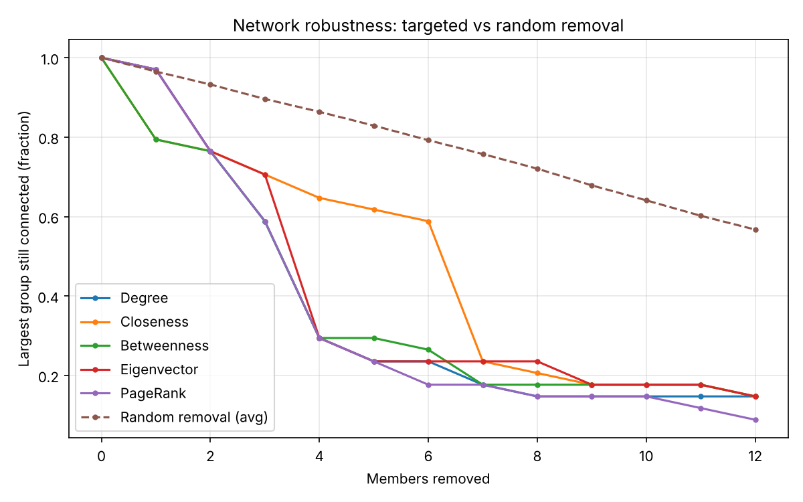

# The Karate Club Split - Social Network Analysis Metrics

**ATSMA Lab Component.** Core centrality metrics (degree, closeness, betweenness, eigenvector, PageRank) computed and interpreted on Zachary's Karate Club, then tested against what actually happened when the club split.

- **Website:** [`website/`](website/) — interactive explainer: each metric's definition, formula, a worked example and a hands-on demo computed live in the browser (deploy steps below)
- **Notebook:** [`notebooks/karate_sna.ipynb`](notebooks/karate_sna.ipynb) — full code, formulas, outputs and interpretation



## Dataset

[Zachary's Karate Club](https://networkrepository.com/soc-karate.php) (Zachary, 1977): friendships among 34 members of a university karate club. A dispute between the instructor (**Mr. Hi**, node 0) and the club administrator (**Officer**, node 33) split the club in two, and we know which side every member joined. That gives a ground truth to validate the metrics against.

| Statistic | Value | | Statistic | Value |
|---|---|---|---|---|
| Members (nodes) | 34 | | Average clustering | 0.571 |
| Friendships (edges) | 78 | | Transitivity | 0.256 |
| Density | 0.139 | | Degree assortativity | −0.476 |
| Max / min degree | 17 / 1 | | Diameter | 5 |
| Average degree | 4.59 | | Average shortest path | 2.41 |

These match the Network Repository page. Its "135 triangles" counts each of the 45 triangles once per corner, and its maximum k-core of 5 uses a different convention from NetworkX's core number (4).

Nodes are numbered 0–33 (NetworkX). Add 1 for the numbering in Zachary's paper.

## Results

### Centrality: top five members

| Metric | #1 | #2 | #3 | #4 | #5 |
|---|---|---|---|---|---|
| Degree | 33 | 0 | 32 | 2 | 1 |
| Closeness | 0 | 2 | 33 | 31 | 13 / 8 (tie) |
| Betweenness | 0 (0.438) | 33 (0.304) | 32 | 2 | 31 |
| Eigenvector | 33 | 0 | 2 | 32 | 1 |
| PageRank | 33 | 0 | 32 | 2 | 1 |

- Every metric puts the **two leaders (0 and 33)** at the top.
- The **Officer wins on popularity and influence** (degree, eigenvector, PageRank). **Mr. Hi wins on reach and brokerage** (closeness, betweenness): he lies on 44% of all shortest paths and is the network's only articulation point (removing him cuts off 6 members).
- Degree and PageRank rank members almost identically (Spearman 0.98). Eigenvector is the most different from the others (≈0.68 with betweenness and PageRank).
- Member **2** is the clearest case where metrics disagree: 10 friends, but 2nd in closeness and 3rd in eigenvector, because it is tied to both camps.

Since the karate graph is undirected, **in-degree / out-degree** are demonstrated on a small directed "who follows whom" example (in the notebook and on the website).

### Community detection vs the real split

| Method | Groups | Modularity | Accuracy* | ARI | NMI |
|---|---|---|---|---|---|
| Girvan–Newman (first split) | 2 | 0.348 | 94% | 0.77 | 0.73 |
| Louvain | 4 | 0.427 | 97% | 0.49 | 0.59 |
| Greedy modularity | 3 | 0.411 | 94% | 0.57 | 0.56 |
| Label propagation | 3 | 0.309 | 85% | 0.38 | 0.36 |
| *Real split* | 2 | 0.391 | 100% | 1.00 | 1.00 |

\*Each detected group mapped to its majority faction.



- **Girvan–Newman**, which cuts the highest-*betweenness* ties, recovers the split for 32 of 34 members. It misplaces 2 and 8, the bridge members.
- A simple rule, **"join the nearer leader"** (shortest-path distance to 0 vs 33), predicts **33 of 34** members. The only miss is member 8, whom Zachary's own model also misplaced.
- **Homophily:** 86% of friendships are within a faction, against 48% expected by chance (attribute assortativity 0.72).

### Robustness



Removing the top 4 members by degree, betweenness, eigenvector or PageRank leaves only **29%** of the club connected; removing 4 random members leaves about **86%**. Removing Mr. Hi alone drops it to 79%; removing the Officer alone, to 97%.

## Repository layout

```
├── website/                     # interactive website (deploy this folder)
│   ├── index.html
│   └── data.js                  # generated by src/sna_analysis.py
├── notebooks/karate_sna.ipynb   # lab notebook (executed, outputs included)
├── src/
│   ├── sna_analysis.py          # computes everything, exports results + website data
│   └── build_notebook.py        # regenerates the notebook
├── data/                        # karate_edges.csv, karate_nodes.csv
├── results/                     # CSV/JSON results and figures
└── requirements.txt
```

## How to run

```bash
pip install -r requirements.txt

# Recompute all results, figures and the website data
python src/sna_analysis.py

# Open the notebook
jupyter notebook notebooks/karate_sna.ipynb
```

The notebook also runs as-is on **Google Colab** or **Kaggle** (all libraries are preinstalled there).

To view the website locally, open `website/index.html` in a browser. No server or build step is needed.

### Deploy the website on Vercel

1. Push this repository to GitHub.
2. On [vercel.com](https://vercel.com), choose **Add New → Project** and import the repository.
3. Set **Root Directory** to `website`, leave **Framework Preset** as **Other**, and leave the build command empty.
4. Click **Deploy**. Vercel gives you a `https://<project>.vercel.app` link, and redeploys on every push.

The site is plain static files (HTML + one data file), so any static host works, including GitHub Pages (serve the `website/` folder).

## References

1. Zachary, W. W. (1977). An information flow model for conflict and fission in small groups. *Journal of Anthropological Research*, 33(4), 452–473.
2. Rossi, R. A. & Ahmed, N. K. (2015). The Network Data Repository with Interactive Graph Analytics and Visualization. *AAAI*. https://networkrepository.com
3. mexwell. *Fundamentals of Social Network Analysis (SNA)*. Kaggle. https://www.kaggle.com/code/mexwell/fundamentals-of-social-network-analysis-sna
4. Hagberg, A., Schult, D. & Swart, P. (2008). Exploring network structure, dynamics, and function using NetworkX. *Proc. SciPy*.
